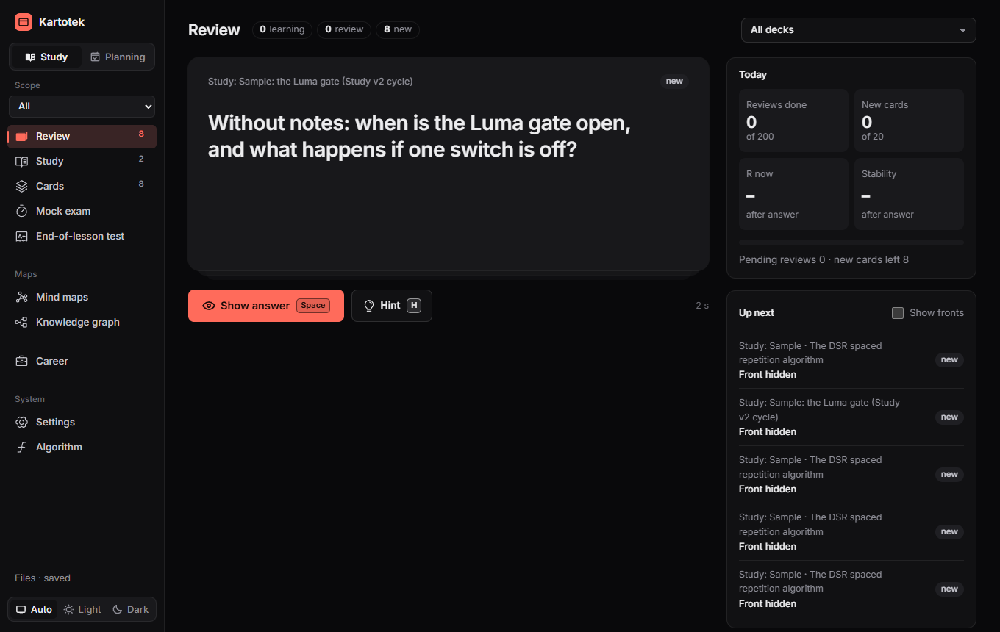
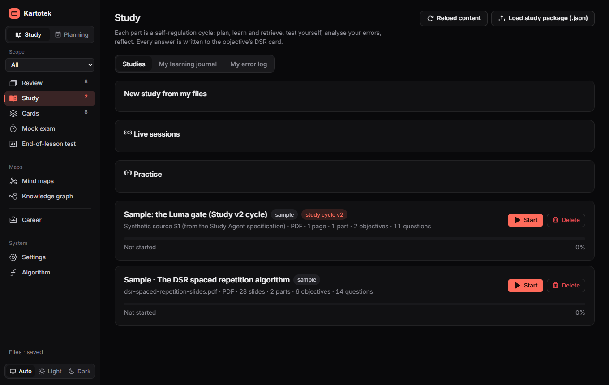
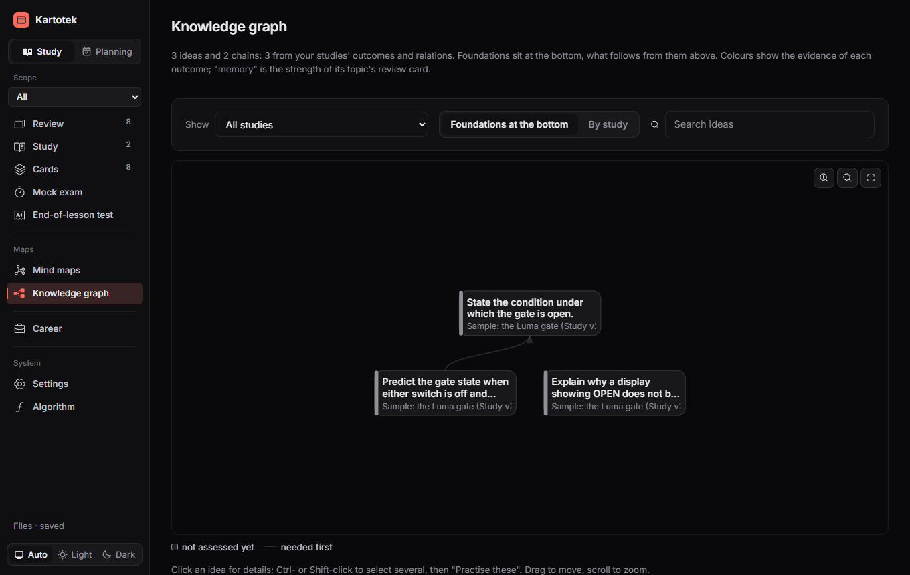
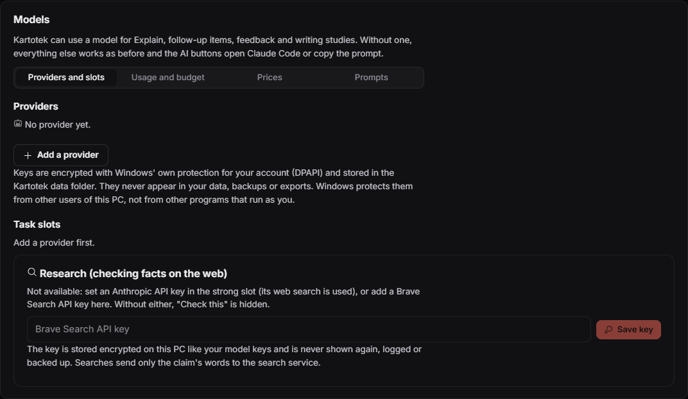

# Kartotek

Kartotek is a study app for Windows that combines spaced repetition with structured studies you write from your own sources. It runs as a desktop app (Electron) or as one self-contained web page, with no server and no account. A model is optional: everything works without one, and the app sends nothing anywhere until you set one up.



## What it does

- **Review**: flash cards scheduled by a D-S-R memory model (difficulty, stability, retrievability) that aims for the retention you choose. Only first, unassisted answers move a card.
- **Study**: studies written from your sources and run as topic cycles (Priming, Learn & digest, Applying, Evaluating) with a delayed final test and an outcome report. Every answer can carry your own thinking (typed or dictated) and a 0 to 100 confidence; a hint ladder gives one rung at a time; "I don't know" is a clear gap, not a wrong guess.
- **Find my level and the plan map**: a short probe finds where you stand per topic, and a plan map shows what to study next. Live sessions teach a goal step by step (predict, teach, check, repair) from your words, your own files or a study.
- **Adaptive practice**: problems whose difficulty follows you, each solved and checked before you see it, with hints and re-tests of what you missed.
- **Knowledge graph**: the ideas your studies teach, what each needs first, and the evidence and memory strength behind each one.
- **End-of-lesson tests, mock exams, mind maps** (checked retrieval from a map you drew), exam-preparation sections and a Planning timeline.
- **Statistics**: retention, calibration of your confidence (study items and lesson tests, plus a separate view for answers to model-written questions), error types, and an Algorithm page that runs the engine's self-tests.
- **Writing in the app**: with a model, Kartotek writes studies, lesson tests and mock exams from your files and checks them (see below). Without one you can still write them with Claude Code from the rule files.
- **Dictation**: a local speech model (whisper.cpp; English, optionally Turkish and Italian) on every thinking field. It is downloaded only when you ask, and your voice never leaves the PC.

Generated material never reaches the scheduler: a card moves only because of an answer you gave to a verified item without help. Help you ask for (hints, Explain, side questions) is recorded and marks the attempt as assisted.





The screenshots show the synthetic samples only (`scripts/screenshots.cjs` takes them).

Your learner data (cards, review log, study progress) stays on your computer: in the desktop app as files in `%APPDATA%\Kartotek`, with a dated backup every day; in the browser page in the browser's storage. Use **Settings, Data, Export backup** to save it to a file; either version can import that file. Learner data is never deleted or rewritten in place, and every change of the saved format ships with a lossless migration.

## Download and first run (Windows)

1. Open the **Releases** page of this repository and download `Kartotek-Setup-<version>.exe` (Windows 10 or 11, 64-bit). `SHA256SUMS.txt` is next to it: `certutil -hashfile Kartotek-Setup-<version>.exe SHA256` prints the checksum to compare.
2. Run it. It installs for your user only (`%LOCALAPPDATA%\Programs\Kartotek`) and needs no administrator rights.
3. Start **Kartotek**. On the very first start it asks what to do with your data: **import a backup file** (the `kartotek-backup-….json` from Settings, Data, Export backup in the browser version, which is also the way to move data from claude.ai), move the data the window already holds, or **start empty**. Imports are checked against the file and a dated backup is kept.
4. Your content (studies, lesson tests, mock exams, mind maps) is read from a folder called `Kartotek Content` in your Documents, or from the folder you choose in **Settings, Content**; press **Reload content** after you add or change a package. Without a folder you see two built-in sample studies.

Your learner data is in `%APPDATA%\Kartotek`. Installing a new version, or uninstalling, never touches it.

**The installer is not signed.** Windows will show a **SmartScreen** warning ("Windows protected your PC"): choose **More info**, then **Run anyway**. On Windows 11 with **Smart App Control** turned on, Windows may refuse to run the installer or the app at all, and there is no way to allow a single file; until the app is signed it cannot be installed on such a PC unless you turn Smart App Control off (Windows Security, App & browser control; this can only be undone by resetting Windows). The browser build below does not have this limit. Code signing is planned (SignPath Foundation, then Azure Artifact Signing). There is no automatic updater: to update, run the newer installer.

How a release is made: `docs/RELEASING.md`. What changed: `CHANGELOG.md`.

## Models (desktop app)

Open **Settings, Models, Providers and slots**, press **Add a provider**, then give a model to each of the three **task slots**: *strong* (writing studies, hard checks, teaching), *fast* (grading proposals, short answers) and *vision* (reading photos and scanned pages; it falls back to strong). **Test connection** makes one small call and shows the reply, the time and the cost. Pick one of the three routes below; you can mix them (for example a subscription client for strong and a local model for fast).



### Route 1: an API key (Anthropic, OpenAI, Google Gemini, OpenRouter)

1. Create an API key in the provider's console. You pay the provider per use; Kartotek shows an estimate before every writing job and can warn at a monthly budget.
2. **Add a provider**, choose the provider and paste the key. It is encrypted with Windows' protection for your account, stored on this PC and never shown again. It never appears in your data, backups, exports, logs or this repository.
3. Choose a model for each slot. Anthropic models can read images and search the web (used by "Check this").

### Route 2: your subscription, through a command-line client

If you already pay for Claude Code or Codex, Kartotek can use that client instead of an API key.

1. Install the client from its own documentation and sign in once in a terminal (`claude` or `codex`). Kartotek also finds the native Claude Code install in `%USERPROFILE%\.local\bin`.
2. **Add a provider**, choose **Claude Code**, **Codex** or **Custom command** (any client that takes a prompt and prints an answer). Kartotek starts the client for each request, in its own work folder, and reads the answer; it never sees your login.
3. A command-line client cannot take images, so give the **vision** slot an API or local model. The cost is shown as "in your subscription", with the API price as a rough equivalent.

### Route 3: a local model (Ollama)

1. Install [Ollama](https://ollama.com), start it, and pull a model (for example `ollama pull gpt-oss:20b`).
2. **Add a provider**, choose **Ollama (local)**; the address is `http://localhost:11434`. The model list shows what you have installed.
3. Choose the model for strong and fast. Local calls are free and nothing leaves your PC, but a 20-billion-parameter model on a laptop takes minutes per answer, and writing a whole study takes long.
4. For the **vision** slot choose a local model that can read images (such as a llava or qwen-vl model). Kartotek asks Ollama which models can, and says so before a job starts if the vision slot cannot; with a text-only model, mind-map reading and scanned pages are not available.

An OpenAI-compatible endpoint (LM Studio, vLLM, a company gateway) works the same way under **OpenAI-compatible endpoint**.

### What a model does for you

With a model set up, the study screens use it directly: **Explain** after an answer, **Practice this again** (one or two new checked questions, kept with your data and never sent to your reviews), **Get feedback** on your own explanation (it quotes your sentences and never rewrites them), a **grading proposal** for written answers that you confirm or change, **Ask about this card** and **Ask about this** (side questions), the hint ladder, Find my level, live teaching, adaptive practice, the knowledge graph's extraction, and **Check this** (a short brief with sources whose links are checked from your PC). What each request says to the model is a prompt file you can read and edit in **Settings, Models, Prompts**; every button also has **Copy prompt** for pasting into any chat. **Usage and budget** shows calls, tokens and estimated cost per day, feature and model.

### Privacy: what is sent to a model, and when

- **Without a model, nothing is sent anywhere.** The browser page never contacts a model.
- **Only when you press a button or Start a job.** Kartotek makes no background calls to a model. A writing job shows its estimate first and sends nothing until you press Start; you can pause it.
- **Only to the provider you chose for that slot.** The text goes to that provider, or to your own PC for Ollama, or to the command-line client, which then sends it under your own account with that vendor.
- **What is sent:**
  - Study screens (Explain, Practice this again, grading proposal, feedback, Ask about this card, hints, side questions): the question or card, what you typed, and the source text stored in the study. A question you have not answered yet is sent without its answer key. Side questions are not offered during Check mode or the final test.
  - Find my level, live sessions, adaptive practice and the knowledge graph: your goal in your words, the study's outcomes and units, and your recent answers with the confidence you gave. For a live session on **your own files**, the text of the pages you chose is sent (it is read on your PC and cached in `%APPDATA%\Kartotek\live`).
  - Writing jobs: the text of the files you chose, read locally from PDF, .pptx, .docx or text. Pages without a usable text layer and mind-map photos are sent as images to the **vision** slot.
  - **Check this** (the researcher): the claim's words go to the strong slot's own web search (Anthropic) or to Brave Search if you added a Brave key. Kartotek then opens each source link from your PC (a HEAD or GET request to that website) to see that it answers.
- **Never sent:** your API keys to anyone but their provider, your learner data as a whole (cards, review log, backups), your content folder as a whole, and your voice recordings.
- **Keys** are encrypted with Windows' protection for your account and never reach the window, logs, backups or the repository.
- **Dictation** runs on your PC. The speech model is downloaded only when you press the download button, from the pinned GitHub and Hugging Face addresses in `desktop/whisper.js`, with a fixed checksum. Recordings are deleted after they are transcribed. Without the local model the button opens Windows voice typing, which is Microsoft's service and follows Microsoft's terms.
- **Generated material is kept apart.** Everything a model writes is recorded as such (`generated_by`, provider and model, prompt version). A study it writes stays a draft until the audit passes, and nothing a model writes reaches the scheduler.

## Writing studies in the app (desktop app)

**Study, New study from my files, Write in the app**: choose your slides, notes or book pages (PDF, .pptx, .docx or text) and the model that writes. Kartotek reads the files on your PC and shows how many calls and tokens the study will take, and what it costs, before anything is sent. It then writes the study step by step in the background (source units, outcomes and criteria, a lesson per topic, practice items, a final test, an audit) and repairs what its own checks find. A separate call then solves every question again without its answer key; only the questions that match are marked verified. The study is saved as a draft in your content folder and stays **Not certified** until the audit reports no blockers; it records which provider and model wrote it. You can pause a job, and it resumes after a restart. The same works for end-of-lesson tests, mock exams, the exam Overview's "write next studies", and mind-map reading and coaching (with a vision model). Claude Code remains available as one of the routes.

## Writing content with Claude Code

Studies, tests, mock exams and mind-map readings can also be written by Claude Code from your files, following the rule files in this repository (`STUDY-RULES.md`, `PRIMING-RULES.md`, `LESSON-TEST-RULES.md`, `MOCK-RULES.md`, `MINDMAP-RULES.md`). Without a model set up, the app builds a prompt for you and opens `claude://` links in your content folder.

## Where your own content lives

The repository holds the app and the samples, not your material. Your studies, lesson tests, mock exams, mind maps and notes live in a **content folder** outside the repository:

```
Kartotek Content\
  studies\      one folder per study, with etut.json
  lessons\      end-of-lesson tests (lesson.json)
  mocks\        mock exams (mock.json)
  mindmaps\     one folder per map, with the photos
  exam\         tud-apply.json, the plan shown in TU Delft AE Prep, Application (optional)
  sources\      page extracts that studies are written from
  notes\        printed note sheets
```

The desktop app finds it as described under "Download and first run". For the Python tools and the browser build, tell Kartotek where it is, in one of three ways (first match wins):

1. `powershell -File build.ps1 -Content "C:\path\to\Kartotek Content"`
2. the environment variable `KARTOTEK_CONTENT`
3. a file `kartotek.config.json` in the repository root (copy `kartotek.config.example.json`; the file is git-ignored)

The paths in the rule files (`studies\<id>`, `pdf-extracts`) are relative to the content folder. Some rule files cite notes under `research\`; that folder is the maintainer's private working material and is not part of this repository.

## Run it from source

You need Windows, [Node.js](https://nodejs.org/) and PowerShell. Python 3 is optional (a local web server and the study audit tool).

```
npm ci                        # root: Electron and the test tools; also installs ui\
npm start                     # builds the UI, opens the app in a desktop window, reloads it when you edit ui\src
npm test                      # engine self-tests (headless), the desktop helpers and the feature suites
```

The window runs the same engine and UI as the browser page. It reads your content folder when it starts and when you press **Reload content** in Settings, so a new or changed study appears without a build; packages that fail their checks are listed under **Content problems**. Development runs use `%APPDATA%\Kartotek-dev` for their data. On Windows 11 with Smart App Control turned on, the unsigned Electron binary may be blocked from starting; `node scripts\bridge-preview.cjs` serves the same app to a normal browser for such a PC.

### The browser page

```
cd ui
npm ci
npm run build                 # builds the interface and copies ui.js and ui.css into src\
cd ..
powershell -ExecutionPolicy Bypass -File build.ps1 -SkipPdf
```

This writes `Kartotek-DSR.html` (and copies your mind-map photos to `mindmaps\` next to it, both git-ignored). Open it in a browser (Edge or Chrome). With a local server instead: `python -m http.server 8765`, then open `http://localhost:8765/Kartotek-DSR.html`. Browser storage is per address, so always open the app the same way. The page has no models and no files: your data lives in the browser's storage, so export a backup now and then.

### Samples and checks

A fresh clone builds with the **synthetic samples** in `samples\`: one Study v2 study and one legacy study. To check that everything works, open the **Algorithm** tab: the engine self-tests run there and should all pass. `python tools\audit-study.py --samples` audits the sample studies. `npm run hygiene` fails if anything private is tracked or has ever been committed.

## Licences

- Code: GNU Affero General Public License v3.0 only (AGPL-3.0-only), see `LICENSE`. Kartotek adapts ideas and prompt texts from LearnHarness by Amos Blomqvist (AGPL-3.0-only); every adapted file names its source. If you run a changed copy as a network service, the AGPL asks you to offer its source to its users.
- Documentation and samples: CC BY 4.0, see `LICENSE-CONTENT.md`.
- Third-party software and the Inter font inside the built files: see `THIRD-PARTY-NOTICES.md`.

Course material, book extracts and personal records are not part of the repository and must not be committed (see `.gitignore` and `CLAUDE.md`).
